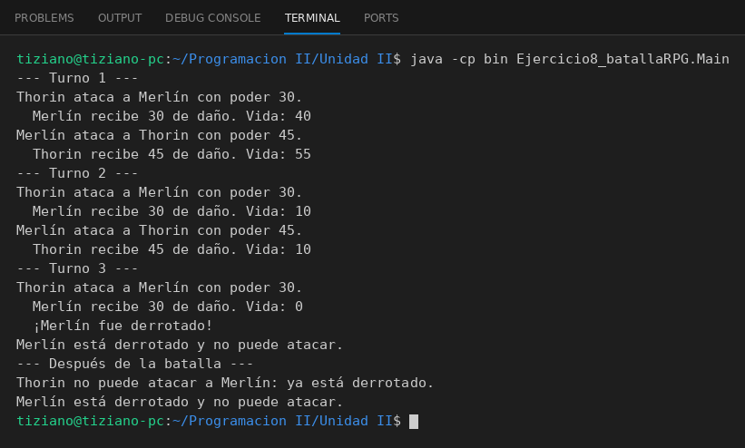

# Personaje

Programación II - Unidad 2 - Ejercicio 8

## Consigna
Dos personajes de un RPG se atacan por turnos; el emisor invoca en el receptor el método que modifica su salud.

## Lógica
- `Personaje`: `nombre`, `puntosVida`, `poderAtaque`.
- `atacar(oponente)`: valida que ni el atacante ni el oponente estén derrotados y llama a `oponente.recibirDanio(poderAtaque)`.
- `recibirDanio(cantidad)`: resta vida sin bajar de 0 y avisa si el personaje es derrotado.
- `Main`: turnos alternados hasta que uno cae, y luego intentos de ataque que se rechazan.

## Ejecución

